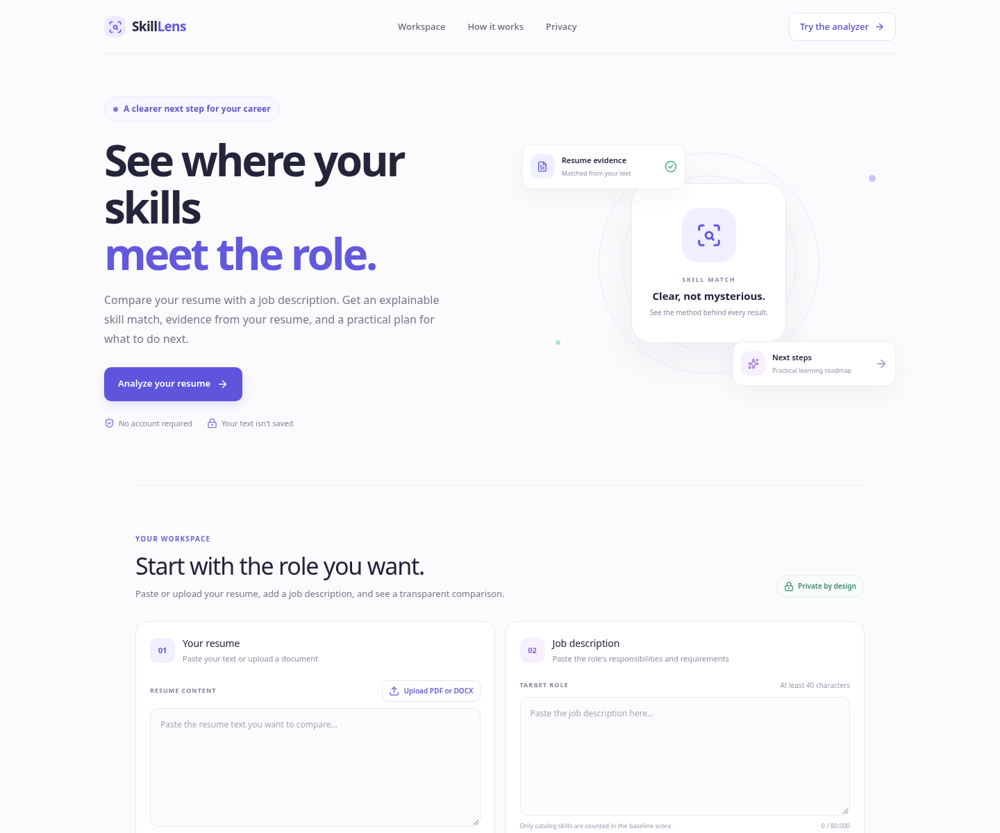

# SkillLens

SkillLens is a stateless resume-to-job skill comparison MVP. It extracts a small, editable catalog of skill mentions, computes an explainable coverage score, shows sentence-level resume evidence, and offers rule-based next steps. PDF and DOCX parsing runs in the API. Optional AI advice is server-side only and falls back to rule-based suggestions when unavailable.

> **Status:** MVP source is implemented and locally verified on 2026-10-18: 18 backend tests, 4 frontend tests, TypeScript typecheck, and a production Vite build passed in the build environment. It is not deployed; no authentication, persistence, or license is included. A score measures mentions from this catalog only; it is not a hiring probability or a measure of proficiency.

## Features

- Paste resume text or upload a PDF/DOCX for review before analysis.
- Compare extracted resume skill mentions with mentions in a target job description.
- See matched requirements, requirements not found in the supplied resume, and supporting sentence snippets.
- Get a transparent baseline score, learning priorities, a short roadmap, and a resume checklist.
- Download an analysis report as Markdown; report generation happens in the browser.
- Optional OpenAI-compatible AI advice configured only through backend environment variables.
- No resume persistence: text is held in browser memory and sent to the API only for parse/analyze requests.

## Architecture

```text
frontend (React + TypeScript + Vite + Tailwind CSS)
    ├── POST /api/resume/parse ──> PyMuPDF / python-docx (in-memory)
    └── POST /api/analyze ───────> skill extraction + score + advice
                                      └── optional AI provider (server-side)
backend (FastAPI + Pydantic)
    └── stateless; no resume or report is saved
```

The deterministic skill catalog lives in `backend/app/models/skills.py`. Extraction, scoring, file parsing, recommendations, and provider integration are separated into small service modules so each can be tested independently.

## Requirements

- Python 3.11 or newer
- Node.js 20.19+ (Node 24 is supported) and npm
- Optional: an API key for an OpenAI-compatible chat-completions endpoint

## Local development

### 1. Start the API

```bash
cd backend
python -m venv .venv
# macOS/Linux
source .venv/bin/activate
# Windows PowerShell: .venv\Scripts\Activate.ps1
pip install -r requirements.txt
cp .env.example .env  # Windows: copy .env.example .env
uvicorn app.main:app --reload --env-file .env
```

The API is at `http://localhost:8000`; interactive documentation is at `http://localhost:8000/docs`.

### 2. Start the frontend

In a second terminal from the repository root:

```bash
cd frontend
npm install
cp .env.example .env  # Windows: copy .env.example .env
npm run dev
```

Open the local URL printed by Vite (normally `http://localhost:5173`). The frontend calls `http://localhost:8000` by default. Set `VITE_API_BASE_URL` in `frontend/.env` when the API is hosted elsewhere.

## Environment variables

Backend values are loaded from `backend/.env` by Uvicorn's `--env-file` option. Never put a provider key in the frontend environment.

| Variable | Default | Purpose |
| --- | --- | --- |
| `FRONTEND_ORIGINS` | `http://localhost:5173,http://127.0.0.1:5173` | Comma-separated CORS allowlist; set exact deployed frontend origins. |
| `MAX_UPLOAD_BYTES` | `5242880` | Maximum PDF/DOCX upload size (5 MiB). |
| `AI_API_KEY` | unset | Optional secret for an OpenAI-compatible chat-completions API. |
| `AI_API_BASE_URL` | `https://api.openai.com/v1/chat/completions` | Full chat-completions endpoint; can be changed for compatible providers. |
| `AI_MODEL` | `gpt-4o-mini` | Model name accepted by the configured endpoint. |
| `AI_TIMEOUT_SECONDS` | `12` | Provider request timeout. |
| `VITE_API_BASE_URL` | `http://localhost:8000` | Frontend API origin; this is not a secret. |

If no AI key is configured, skill matching still works and the UI says advice is rule-based. Provider errors also fall back to rule-based suggestions. AI responses are validated before they are shown.

## API endpoints

| Method | Endpoint | Description |
| --- | --- | --- |
| `GET` | `/api/health` | Service health and whether optional AI is configured. |
| `GET` | `/api/skills` | Supported skill names and matching caveat. |
| `POST` | `/api/resume/parse` | Multipart PDF/DOCX upload; returns extracted text for user review. |
| `POST` | `/api/analyze` | JSON `{ "resume_text": "...", "job_description": "..." }`; returns score, evidence, priorities, and roadmap. |

Invalid input returns a consistent JSON error object. FastAPI's interactive schema is available at `/docs`. Text inputs must contain at least 40 non-whitespace characters and are limited to 80,000 characters. Uploads are limited to 5 MiB by default.

## Score and interpretation

The baseline is **100 × matched unique identified job-description skills ÷ all unique identified job-description skills**. A skill is matched when its canonical name is found in both inputs using word-aware alias patterns. The denominator is the set recognized by the small catalog, not every qualification in the posting. If no catalog skills are detected in the job description, the score is `null` and the interface says it cannot be calculated.

This is a reproducible mention-coverage indicator. It does not judge skill depth, recency, context, seniority, soft skills, or hiring outcomes. “Not found in the supplied resume” means only that the submitted text did not contain a recognized mention; it does not establish that a person lacks the skill. Evidence snippets show matching text, not verified credentials.

## Privacy and security

- Resume text is not stored in a database, written to disk, or included in application logs.
- Upload bytes are read in memory, type/size checked, parsed in memory, and discarded after the response. Scanned/image-only PDFs without selectable text return an actionable error.
- The browser sends text only when the user requests parsing or analysis. The analysis report is generated locally in the browser.
- Optional AI advice sends the current resume/job text to the configured provider. Do not enable AI unless you are comfortable with that provider's data handling. The provider key stays on the backend.
- Uploaded resume text and job descriptions are treated as untrusted data, not instructions.
- Configure exact CORS origins for deployment. No authentication or persistence is included in this MVP.

## Tests and quality checks

Backend (from `backend/`):

```bash
pytest
```

Frontend (from `frontend/`):

```bash
npm test
npm run typecheck
npm run build
```

The backend tests cover normalization, matching, score edge cases, file parsing and validation, API errors, and AI fallback/error behavior. The frontend tests cover empty-state/form behavior and score display. Run the commands above in your own environment before making release or deployment claims.

## Deploy on Render

The repository includes a Render Blueprint and a multi-stage Dockerfile that build the frontend and serve it with the FastAPI API from one origin. To publish a live instance, create a Render account, connect this public GitHub repository, and deploy the Blueprint using `render.yaml`. Render will build from the repository root and check `/api/health` after startup. No AI key is required; without one, recommendations remain rule-based.

The Blueprint selects Render's free web-service plan for this portfolio demo. Free web services can spin down after inactivity, so the first request after a quiet period may take longer. The app is stateless and does not intentionally retain resume text; users should still avoid submitting sensitive information to any public demo. For a production deployment, review provider data handling, availability, and plan limits first.

## Screenshots



## Known limitations and next steps

- The skill vocabulary is intentionally small and can miss synonyms, domain-specific skills, and non-technical requirements. Extend `backend/app/models/skills.py` and add tests when expanding it.
- Mention matching does not infer proficiency or verify claims. The score is not a hiring prediction.
- AI advice is optional and provider-dependent; structured output validation cannot guarantee factual correctness. Review advice before using it.
- No accounts, saved analyses, persistent history, deployment, or CI workflow are configured.
- Potential next improvements: broaden and version the skill taxonomy, add user-reviewed requirement extraction, improve accessibility testing, set up CI, and deploy with explicit privacy and CORS settings.

## License

No license has been added. Choose a license before granting reuse rights.
